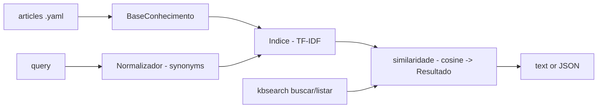

# kb-search

**English** · [Português (Brasil)](README.md)

[](#) [](#) [](#) [](LICENSE)

## What it is

**A knowledge-base search engine (own implementation)**: it indexes **YAML articles**, with **synonym normalisation** (`Normalizador`) and a hand-rolled **TF-IDF + cosine-similarity** ranking (stdlib, pandas-free). Output in text or **JSON**. It is an educational lexical-search lab (embedding-free).

## Status

An educational lab, working and tested (84 tests).

## Features

- **Corpus** (`busca.py`): `Artigo` (id/title/text/category), `BaseConhecimento.carregar_base` (YAML), a `Resultado` with score.
- **Index** (`indexador.py`): `tokenizar`, an `Indice` with TF-IDF (`_normalizar`/matrix), cosine `similaridade`.
- **Normalisation** (`normalizacao.py`): `carregar_sinonimos` (YAML) and `Normalizador` with `padroesPadrao` — query and docs share one vocabulary.
- **CLI** (`kbsearch`): `buscar <query> [--top N --categoria]` (text or JSON) and `listar` (all articles).

## Architecture

A `kbsearch` package with `normalizacao` (synonyms), `indexador` (pure TF-IDF), `busca` (corpus + top-k) and `cli.py`.



## Stack

- Python ≥ 3.10, stdlib only (pandas-free)
- PyYAML ≥ 6.0
- pytest (dev)

## Repository layout

```
kb-search/
├── pyproject.toml · BRIEF.md
├── src/kbsearch/
│   ├── busca.py       # BaseConhecimento/Resultado corpus
│   ├── indexador.py   # TF-IDF + cosine
│   ├── normalizacao.py # synonyms
│   └── cli.py
├── dados/             # kb.yaml + sinonimos.yaml
├── tests/             # 84 tests
└── LICENSE            # MIT
```

## Prerequisites and installation

```bash
pip install -e .
```

## How to run

```bash
kbsearch buscar "vpn does not connect" --top 3
kbsearch buscar "printer" --categoria hardware --json
kbsearch listar
```

## Tests and quality

Real command (verified by the agent):

```bash
PYTHONPATH=src python -m pytest tests/
# 84 passed
```

## Technical decisions and trade-offs

- **Hand-rolled TF-IDF**: total ranking transparency; the trade-off is no semantic embeddings (synonyms covered by explicit normalisation).
- **YAML synonyms**: the base vocabulary is owner-controlled.
- **Pure stdlib**: light and auditable.

## Known limitations and roadmap

- Lexical search — it does not understand semantics beyond the declared synonyms.
- Small in-memory corpus (no optimised inverted index for large bases).

## Development process

An individual project by Kelvin Oliveira, built with orchestrated AI agents and reviewed by the author.

## License and author

MIT — Copyright (c) 2026 Kelvin Rebelo de Oliveira. Author: [Kelvin Oliveira](https://github.com/KelvinOliveiraCode) · [Portfolio](https://kelvinoliveiracode.github.io/portfolio/)
