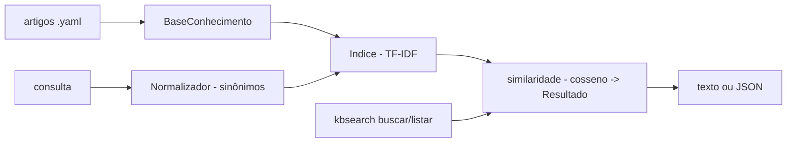

# kb-search

[English](README.en.md) · **Português (Brasil)**

[](#) [](#) [](#) [](LICENSE)

## O que é

**Busca em base de conhecimento (motor próprio)**: indexa **artigos em YAML**, com **normalização de sinônimos** (`Normalizador`) e ranking **TF-IDF + similaridade de cosseno** implementado à mão (stdlib pandas-free). Saída em texto ou **JSON**. É um laboratório educacional de busca lexical (embedding-free).

## Status

Laboratório educacional funcional e testado (84 testes).

## Funcionalidades

- **Corpus** (`busca.py`): `Artigo` (id/título/texto/categoria), `BaseConhecimento.carregar_base` (YAML), `Resultado` com score.
- **Índice** (`indexador.py`): `tokenizar`, `Indice` com TF-IDF (`_normalizar/matriz`), `similaridade` de cosseno.
- **Normalização** (`normalizacao.py`): `carregar_sinonimos` (YAML) e `Normalizador` com `padroesPadrao` — consulta e docs no mesmo vocabulário.
- **CLI** (`kbsearch`): `buscar <consulta> [--top N --categoria]` (texto ou JSON) e `listar` (todos os artigos).

## Arquitetura

Pacote `kbsearch` com `normalizacao` (sinônimos), `indexador` (TF-IDF puro), `busca` (corpus + top-k) e `cli.py`.



## Stack

- Python ≥ 3.10, stdlib apenas (pandas-free)
- PyYAML ≥ 6.0
- pytest (dev)

## Estrutura do repositório

```
kb-search/
├── pyproject.toml · BRIEF.md
├── src/kbsearch/
│   ├── busca.py       # corpus BaseConhecimento/Resultado
│   ├── indexador.py   # TF-IDF + cosseno
│   ├── normalizacao.py # sinônimos
│   └── cli.py
├── dados/             # kb.yaml + sinonimos.yaml
├── tests/             # 84 testes
└── LICENSE            # MIT
```

## Pré-requisitos e instalação

```bash
pip install -e .
```

## Como executar

```bash
kbsearch buscar "vpn não conecta" --top 3
kbsearch buscar "impressora" --categoria hardware --json
kbsearch listar
```

## Testes e qualidade

Comando real (verificado pelo agente):

```bash
PYTHONPATH=src python -m pytest tests/
# 84 passed
```

## Decisões técnicas e trade-offs

- **TF-IDF implementado à mão**: transparência total do ranking; em troca, sem embeddings semânticos (sinônimos cobertos por normalização explícita).
- **Sinônimos em YAML**: vocabulário da base controlado pelo dono.
- **Stdlib pura**: leve e auditável.

## Limitações conhecidas e roadmap

- Busca lexical — não entende semântica além dos sinônimos declarados.
- Corpus pequeno em memória (sem índice invertido amortizado para bases grandes).

## Processo de desenvolvimento

Projeto individual de Kelvin Oliveira, construído com agentes de IA orquestrados e revisado pelo autor.

## Licença e autor

MIT — Copyright (c) 2026 Kelvin Rebelo de Oliveira. Autor: [Kelvin Oliveira](https://github.com/KelvinOliveiraCode) · [Portfólio](https://kelvinoliveiracode.github.io/portfolio/)
